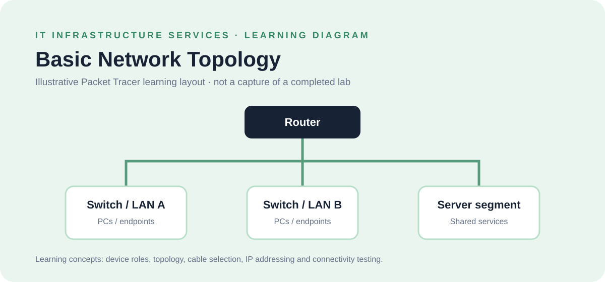
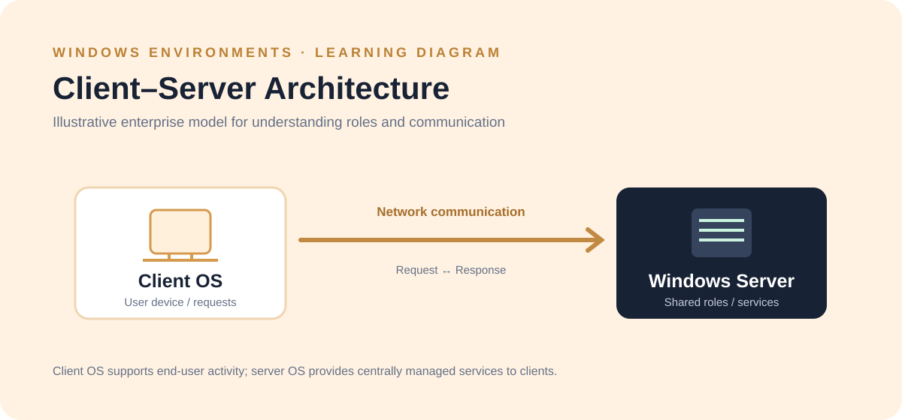

# IT Infrastructure Services
### Training & Lab Learning

## Overview
This page summarises foundational topics studied during IT Infrastructure Services (ITIS) training.

## Networking fundamentals
- Basic network communication concepts
- Network devices and their roles
- Network topologies
- Router connectivity and cable selection concepts

## Cisco Packet Tracer
- Exploring the Packet Tracer workspace
- Placing network devices
- Connecting devices using appropriate cables
- Building and inspecting basic topologies

## Windows environments

- Windows Client OS fundamentals
- Windows Server fundamentals
- Understanding the different purposes of client and server operating systems

## Virtualization and security concepts
- Virtual hard disks and the VHDX format
- Secure Boot fundamentals
- Trusted Platform Module (TPM) fundamentals

## Practical learning checklist
- [ ] Document the exact Packet Tracer topology practised
- [ ] Add permitted lab screenshots
- [ ] Record device models, cable types and addressing used in the lab
- [ ] Add short notes explaining connectivity tests

> **Transparency note:** The diagrams on this page are illustrative learning aids, not screenshots or proof of a completed lab. Add genuine lab evidence only when available and permitted.
