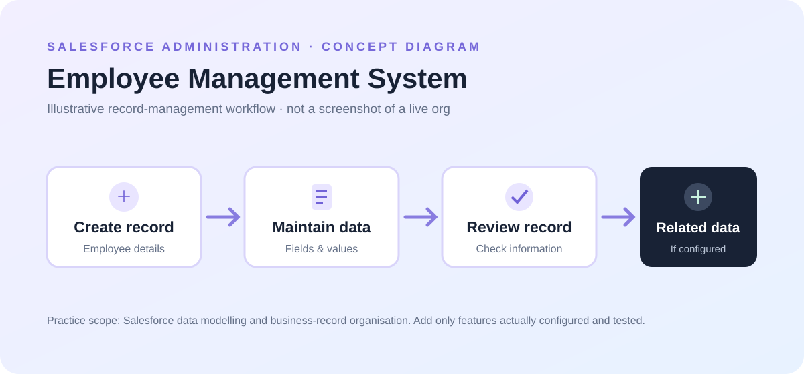
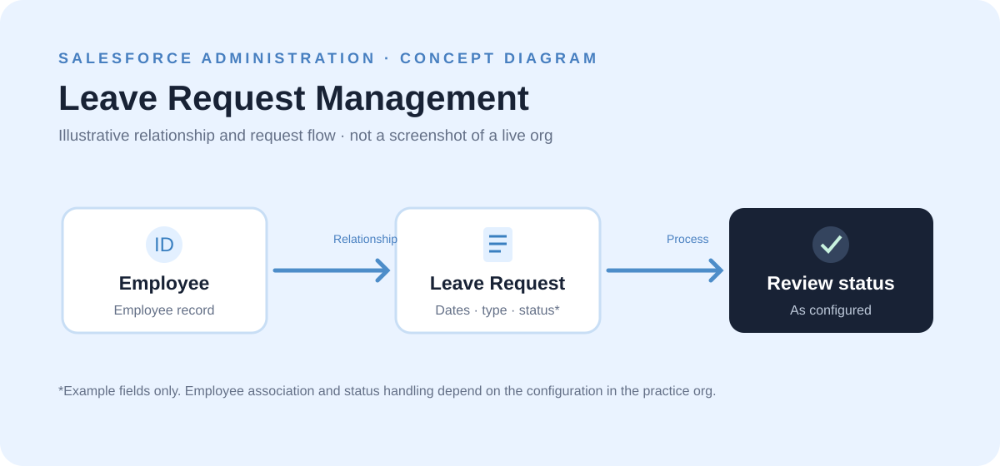
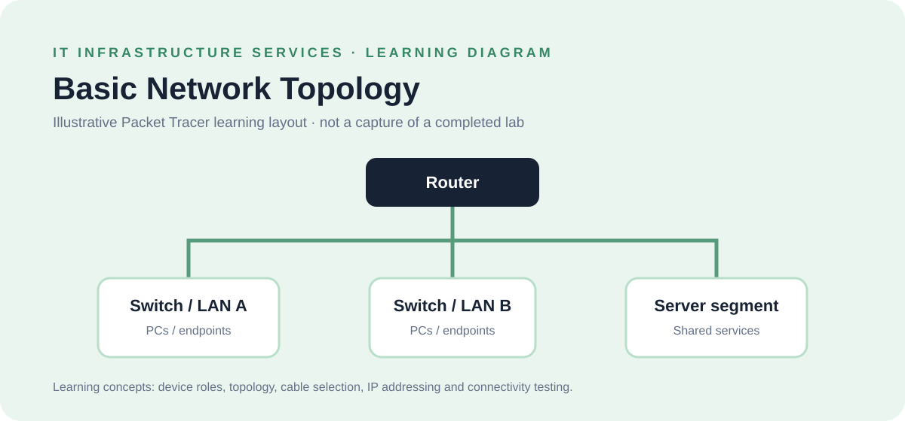
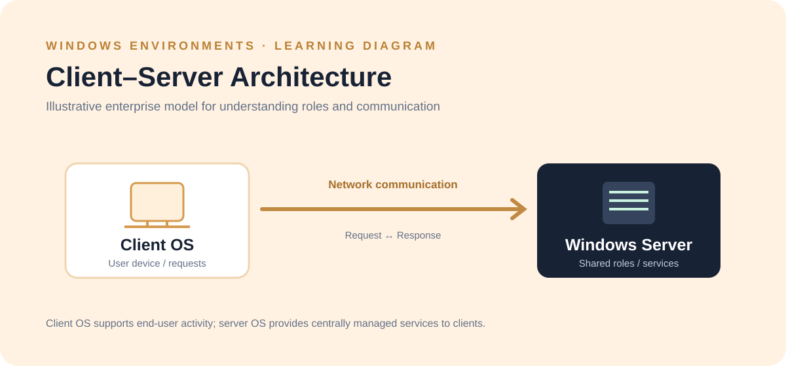

# Harshitha | IT Infrastructure & Salesforce Portfolio

  
  
  

  <b>Assistant System Engineer Trainee @ TCS</b> 
  IT Infrastructure Services · Salesforce Administration · Biomedical Engineering

  <a href="https://harshitha23833.github.io/harshitha-portfolio/">🌐 View Portfolio Website</a> ·
  <a href="https://github.com/Harshitha23833">GitHub Profile</a>

---

## About

I am a 2026 B.Tech Biomedical Engineering graduate from **Vel Tech Rangarajan Dr. Sagunthala R&D Institute of Science and Technology, Chennai**, with a CGPA of **9.26**. I currently work as an **Assistant System Engineer Trainee at Tata Consultancy Services (TCS)** in the **IT Infrastructure Services (ITIS)** domain.

I am developing my technical foundation through structured learning and practice in networking, Windows environments, virtualization, security fundamentals and Salesforce Administration.

## At a glance

| Area | Details |
|---|---|
| Current role | Assistant System Engineer Trainee — TCS |
| Domain | IT Infrastructure Services |
| Education | B.Tech Biomedical Engineering, 2026 |
| Academic CGPA | 9.26 |
| Core learning | Networking, Windows OS, virtualization, Salesforce Admin |
| Programming / data | Python, MySQL, SQL fundamentals |
| Location | Chennai, India |

## Featured projects

### Salesforce Administration — practice projects

- **[Employee Management System](Salesforce/Employee-Management-System/README.md)** — practice project focused on employee records and Salesforce data modelling.
- **[Leave Request Management System](Salesforce/Leave-Request-Management-System/README.md)** — practice project exploring leave records and employee relationships.

### IT Infrastructure Services — training & lab learning

- **[ITIS Learning Notes](IT-Infrastructure-Services/README.md)** — networking fundamentals, Cisco Packet Tracer, Windows Client OS, Windows Server, VHDX, Secure Boot and TPM.

### Biomedical Engineering — academic work

- **[Academic Projects](Academic-Projects/README.md)** — IoT-based remote monitoring and biomolecule sensing.

## Visual project guides

These are **original illustrative diagrams** created to explain concepts. They are not screenshots of a live Salesforce org or evidence of completed Packet Tracer configurations.

| Topic | Diagram |
|---|---|
| Employee management workflow |  |
| Leave request workflow |  |
| Basic network topology |  |
| Client–server architecture |  |

## Skills & learning areas

- **IT Infrastructure:** Networking fundamentals, topologies, Cisco Packet Tracer, Windows Client OS, Windows Server, virtualization, VHDX, Secure Boot and TPM.
- **Salesforce Administration:** Custom objects and fields, lookup and master-detail relationship concepts, Flow Builder concepts, record and data management.
- **Programming & data:** Python, MySQL and SQL fundamentals.
- **Engineering foundation:** Biomedical engineering, IoT monitoring concepts and sensor-based systems.

See the detailed [Skills overview](Skills/README.md).

## Experience

**Tata Consultancy Services (TCS)** — Assistant System Engineer Trainee  
**Domain:** IT Infrastructure Services (ITIS)

Current learning areas include networking, Windows environments, virtualization and infrastructure security fundamentals. This portfolio describes training and lab learning; it does not claim production project ownership.

## Education

**B.Tech — Biomedical Engineering**  
Vel Tech Rangarajan Dr. Sagunthala R&D Institute of Science and Technology, Chennai  
2022–2026 · **CGPA: 9.26**

## Connect

- GitHub: [@Harshitha23833](https://github.com/Harshitha23833)
- Portfolio: [harshitha23833.github.io/harshitha-portfolio](https://harshitha23833.github.io/harshitha-portfolio/)

---

<i>Curious mind. Practical learner. Always building.</i>

