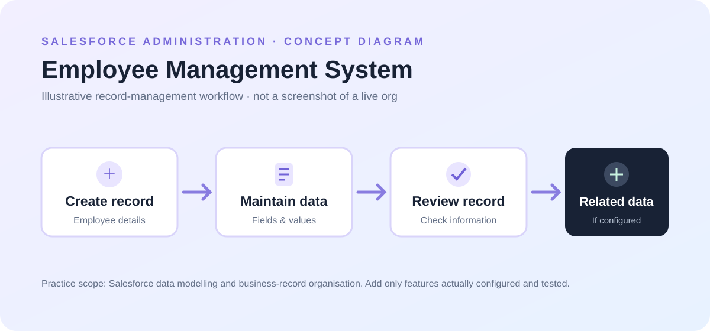

# Employee Management System
### Salesforce Administration · Practice Project

## Project overview
A Salesforce practice project designed to organise employee-related information using Salesforce's declarative platform.

## Objective
- Practise modelling employee information in Salesforce.
- Understand how records and fields organise business data.
- Build familiarity with Salesforce Administration concepts.

## Conceptual workflow
1. Create or open an employee record.
2. Enter and maintain the employee information captured by the project.
3. Review the record and any related information configured in the org.

## Configuration record
Document the exact setup from the Salesforce practice org. Include only features actually configured and tested.

| Configuration area | What to document |
|---|---|
| Object and fields | Actual custom object name and fields |
| Relationships | Lookup or master-detail, if configured |
| Record interface | Page layout / record page, if configured |
| Automation | Flow or validation rule, only if implemented |
| Access | Profiles, permission sets or sharing, only if configured |

## Learning outcomes
- Salesforce record and field concepts
- Declarative data modelling
- Understanding how business records are organised

## Evidence checklist
- [ ] Object Manager screenshot
- [ ] Fields and relationships screenshot
- [ ] Sample record using fictional data
- [ ] Automation screenshot, only if implemented

> **Transparency note:** The diagram above is an illustrative explanation, not a screenshot of a live Salesforce org. This is a practice project, not a production deployment.
