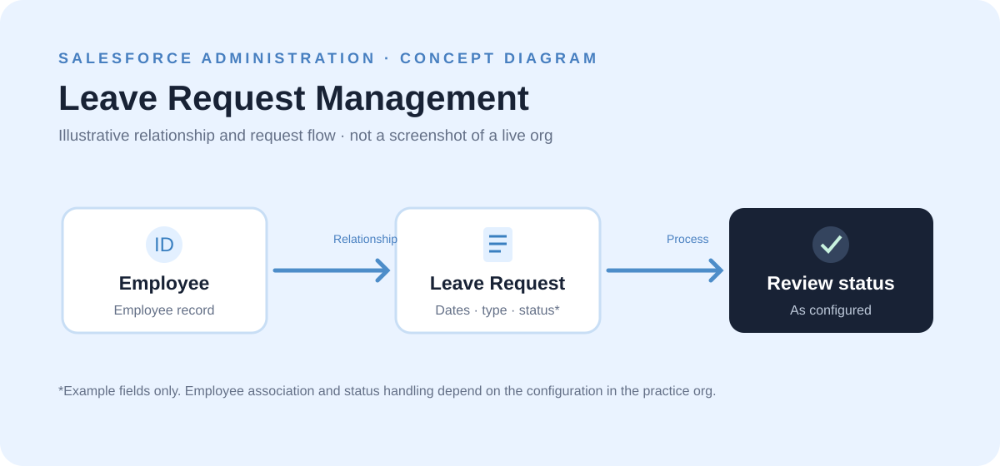

# Leave Request Management System
### Salesforce Administration · Practice Project

## Project overview
A Salesforce practice project for recording employee leave requests and understanding how a request can be associated with an employee record.

## Objective
- Practise representing leave requests as Salesforce records.
- Understand the relationship between an employee and their leave request.
- Explore how a business process can be represented declaratively.

## Conceptual workflow
1. An employee record is available in Salesforce.
2. A leave request record is created.
3. The request is associated with the relevant employee.
4. The request status is reviewed and updated according to the configuration.

## Configuration record
Document the exact implementation in your practice org.

| Configuration area | What to document |
|---|---|
| Leave Request object | Actual object name and fields |
| Employee relationship | Lookup or master-detail, as configured |
| Request information | Leave type, dates and status, if included |
| Automation | Flow / approval process, only if implemented |
| Access | Actual access settings, if configured |

## Learning outcomes
- Record-based process modelling
- Object relationship concepts
- Understanding a simple business workflow in Salesforce

## Evidence checklist
- [ ] Leave Request object and fields
- [ ] Employee relationship
- [ ] Sample request using fictional data
- [ ] Automation or approval configuration, only if implemented

> **Transparency note:** This is a practice project. The diagram is illustrative and does not claim a live org screenshot, approval automation or production deployment.
